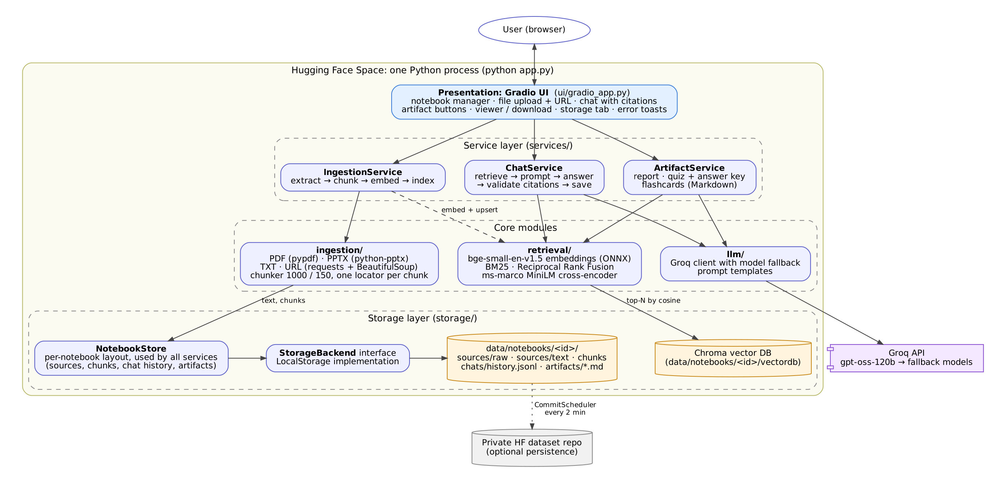

# 📓 NotebookLM Clone

**Sourcebook** is a full-stack RAG app in the style of Google's NotebookLM. You create notebooks, add PDFs, slide decks, text files or web pages, ask questions and get answers with citations, and generate a report, a quiz with an answer key, or flashcards from the notebook.

- **Live app (Google Cloud Run):** https://notebooklm-clone-XXXXXXXX.us-central1.run.app  <!-- replace with your URL after the first deploy -->
- **Architecture:** [docs/ARCHITECTURE.md](docs/ARCHITECTURE.md)
- **RAG evaluation:** [docs/RAG_EVALUATION.md](docs/RAG_EVALUATION.md) (raw results in [eval/results/](eval/results/))



## Features

| Area | What you get |
|---|---|
| Notebooks | Create, rename, delete and switch notebooks. Each one has its own sources, vector index, chat history and artifacts. |
| Sources | PDF (cited by page), PPTX (by slide, including speaker notes and tables), TXT/MD (by line range) and web URLs (by heading section; a URL that points to a PDF works too). Duplicates are rejected, and each source can be switched on or off. |
| RAG chat | Four retrieval strategies: vector, hybrid BM25 + vector (the default), vector + cross-encoder rerank, and hybrid + rerank. Answers cite `[n]`, and a source list under each answer shows file · page/slide · snippet. A *How this answer was found* panel shows the retrieved chunks, their scores and timings. The history is saved per notebook. |
| Artifacts | A report, a quiz with an answer key, and flashcards (an extra). All are saved as `.md` in the notebook, shown in the app and downloadable. An optional *focus* topic narrows any of them. |
| Storage | A per-notebook folder layout behind a storage abstraction (`StorageBackend` → `NotebookStore`), with a *Storage* tab that shows the folder tree. |
| Interface | A clean, responsive Gradio UI with light and dark themes. Citations are the one highlighted element on the page, so it's easy to see where every claim comes from. The footer has author links. |
| Errors | Friendly messages for unsupported or scanned files, oversized uploads, unreachable or private URLs, a missing or invalid API key, rate limits and model retirements. Groq models fall back automatically. |
| Deployment | GitHub Actions runs the tests, builds the Docker image, deploys it to Google Cloud Run, and checks that the live URL answers. It authenticates with Workload Identity Federation, so no Google key is stored anywhere. |

## Run it locally

You need Python 3.11+ and a free Groq API key from https://console.groq.com/keys.

**Windows (PowerShell)**

```powershell
git clone https://github.com/<your-username>/notebooklm-clone.git
cd notebooklm-clone
py -3.11 -m venv .venv
.\.venv\Scripts\Activate.ps1
pip install -r requirements.txt
Copy-Item .env.example .env      # then open .env and paste your GROQ_API_KEY
python app.py                    # open http://127.0.0.1:7860
```

**macOS / Linux**

```bash
git clone https://github.com/<your-username>/notebooklm-clone.git && cd notebooklm-clone
python3.11 -m venv .venv && source .venv/bin/activate
pip install -r requirements.txt
cp .env.example .env             # add GROQ_API_KEY
python app.py
```

The first start downloads two small ONNX models (about 150 MB) into `.model_cache/`. The models load in the background, so the first question can take a few extra seconds.

## Environment variables

| Variable | Required | Default | Purpose |
|---|---|---|---|
| `GROQ_API_KEY` | yes | – | Groq key for answers and artifacts |
| `GROQ_MODELS` | no | `openai/gpt-oss-120b,openai/gpt-oss-20b,llama-3.3-70b-versatile,llama-3.1-8b-instant` | Preferred model first, then fallbacks |
| `RETRIEVAL_METHOD` | no | `hybrid` | `vector`, `hybrid`, `rerank` or `hybrid_rerank` |
| `TOP_K` / `CANDIDATE_K` | no | `5` / `20` | Chunks sent to the LLM / candidates for fusion and reranking |
| `CHUNK_SIZE` / `CHUNK_OVERLAP` | no | `1000` / `150` | Chunking, in characters |
| `DATA_DIR` | no | `./data` | Where notebooks are stored |
| `MAX_UPLOAD_MB` | no | `25` | Upload size limit |
| `APP_USERNAME` / `APP_PASSWORD` | no | – | Turns on a login screen (recommended for a public URL) |
| `HF_DATASET_REPO` / `HF_TOKEN` | no | – | Optional: keep notebooks across Cloud Run restarts by syncing to a private Hugging Face dataset (see *How data is stored*) |
| `UI_STYLE` | no | `scholar` | Look of the interface: `scholar` (teal), `indigo`, `studio` (NotebookLM-like) or `midnight` (dark) |
| `PORT` | no | – | When set, the app listens on `0.0.0.0:$PORT` (Docker / Cloud Run) |

Keys live in `.env` locally. In the cloud, `GROQ_API_KEY` is in Google Secret Manager and the deploy credentials are GitHub Actions secrets. `.env` is git-ignored, and only `.env.example` is committed.

## Project structure

```
app.py                         entry point (local and Docker / Cloud Run)
notebooklm/
  config.py                    settings from environment variables
  models.py                    dataclasses: Notebook, Source, Segment, Chunk, ChatMessage, Artifact
  storage/                     StorageBackend interface, LocalStorage, NotebookStore (layout), HF dataset sync
  ingestion/                   extractors (PDF/PPTX/TXT/URL), chunker, IngestionService
  retrieval/                   embeddings, Chroma vector store, BM25, cross-encoder, Retriever (4 strategies)
  llm/                         Groq client with fallback, prompt templates
  services/                    ChatService, ArtifactService, composition root (container.py)
  ui/gradio_app.py             Gradio layout + thin callbacks
eval/                          corpus, questions, run_eval.py, results/
tests/                         offline pytest suite (runs in CI)
scripts/gcp_setup.sh           one-time Google Cloud setup (run in Cloud Shell)
scripts/download_models.py     bakes the ONNX models into the Docker image
.github/workflows/deploy.yml   CI/CD: test → build image → deploy to Cloud Run → check the live URL
docs/                          architecture, RAG evaluation, diagrams
Dockerfile                     container image deployed to Cloud Run
```

Each layer only calls the one below it: UI → services → ingestion/retrieval/llm → storage. See [docs/ARCHITECTURE.md](docs/ARCHITECTURE.md) for what each module does and how data moves between them.

## How data is stored

Everything a notebook owns lives in its own folder:

```
data/notebooks/<notebook_id>/
  notebook.json          name and timestamps
  sources/sources.json   source records (type, origin, chunk count, enabled flag)
  sources/raw/           original uploads / fetched pages
  sources/text/          extracted text, split into citable segments (.json) and readable (.txt)
  chunks/<source>.jsonl  chunks + citation metadata (the source of truth)
  vectordb/              Chroma index for this notebook (rebuilt from chunks if missing)
  chats/history.jsonl    chat messages with their citations
  artifacts/             generated .md files + index.json
```

Locally, all of it survives restarts. **On Cloud Run the disk is temporary.** The container's file system lives in memory, so notebooks on the deployed app are lost when the service scales to zero after being idle, or when a new version is deployed. This is a deliberate trade-off for a free deployment. The app is capped at one instance, so everyone using it sees the same notebooks while it's running.

To keep notebooks across restarts without changing any code, set `HF_DATASET_REPO=<user>/notebooklm-data` and an `HF_TOKEN` with write access (for example with `--set-env-vars` and `--set-secrets` in the deploy step). On start the app restores notebooks from that private dataset repo, then pushes changes every 2 minutes. The Chroma index isn't synced; it gets rebuilt from the chunk files. Changes from the last couple of minutes before a restart can be lost.

## Using the app

1. **Create a notebook:** type a name under *Notebooks* and press *Create*. Switch notebooks with *Open notebook*, and rename or delete one under *Rename or delete this notebook*.
2. **Add sources:** drop PDF, PPTX or TXT files and press *Add files to notebook*, or paste a link under *Add a web page* and press *Add page*. The status list shows how many pages, slides or sections and passages each source produced. Untick a source under *Use these sources* to leave it out.
3. **Chat:** ask a question. The highlighted numbers in the answer are citations, and the *Sources* list under it shows the file and the page, slide or line range for each one. Open *How this answer was found* to see the retrieved chunks, scores and timings, and change *How to search your sources* to compare retrieval methods.
4. **Study material:** on the *Study material* tab, press *Write report*, *Make quiz* or *Make flashcards*, optionally with a topic. Pick anything under *Saved in this notebook* to read it or download the `.md` file.
5. **Storage:** the *Storage* tab shows the notebook's folder on disk.

## RAG evaluation

`eval/run_eval.py` loads a fixed corpus (1 PDF, 1 PPTX, 2 TXT files describing a fictional company, so the LLM can't answer from memory) and asks 12 questions. It records the retrieved chunks, Hit@k, MRR, retrieval latency, end-to-end response time, and LLM-judged correctness and groundedness for each strategy.

```powershell
python -m eval.run_eval                       # retrieval for all 4 methods, answers for vector vs hybrid+rerank
python -m eval.run_eval --answer-methods all  # answers for all 4 methods
```

Short version: on this corpus all four methods found the evidence in the top 3 for every answerable question, and answer quality was the same within the judge's noise. The cross-encoder reranker added about 2.6 s per question on a laptop CPU without improving accuracy, so the default is **hybrid**: as accurate as the best method at about 100 ms, with BM25 as a cheap safeguard for exact codes and IDs. Full tables, retrieved chunks and trade-offs are in [docs/RAG_EVALUATION.md](docs/RAG_EVALUATION.md).

## Deployment (Google Cloud Run + GitHub Actions)

The app runs on **Google Cloud Run** as a single container. Hugging Face now requires a paid plan for new Gradio and Docker Spaces, while Cloud Run's free tier (with the Google Cloud free-trial credit behind it) covers a class project.

**One-time setup**

1. In the [Google Cloud console](https://console.cloud.google.com), create a project and make sure billing is linked (the free trial is enough).
2. Open **Cloud Shell** (the `>_` icon, top right) and run:
   ```bash
   gcloud config set project YOUR_PROJECT_ID
   bash <(curl -fsSL https://raw.githubusercontent.com/<your-username>/notebooklm-clone/main/scripts/gcp_setup.sh)
   ```
   The script enables the APIs, creates an Artifact Registry repository, asks for your Groq key and stores it in Secret Manager, creates a runtime and a deployer service account, and sets up Workload Identity Federation for this GitHub repo. It's safe to run again.
3. Add the three values it prints as GitHub Actions secrets (**Settings → Secrets and variables → Actions**): `GCP_PROJECT_ID`, `GCP_WIF_PROVIDER` and `GCP_SERVICE_ACCOUNT`.

**Every push to `main`** then runs `.github/workflows/deploy.yml`:

```
push → test (pytest, offline) → docker build (cached) → push to Artifact Registry → gcloud run deploy → GET live URL expects HTTP 200
```

A green run means the new revision is serving. The URL is printed in the run summary and on the service page under **Cloud Run → Services → notebooklm-clone**, and stays the same across deploys. The service uses 2 GiB of memory and 1 vCPU, scales to zero when idle (the first request after a while takes about 15–30 s), and is capped at one instance.

**Costs and keeping it online.** Low traffic fits inside Cloud Run's always-free monthly allowance: 2 million requests, 180,000 vCPU-seconds and 360,000 GB-seconds of memory, which works out to roughly 45–50 hours of active use a month with this service's settings. The service scales to zero, so idle time is free. The setup script keeps only the two newest images, which holds Artifact Registry storage close to its free 0.5 GB. The 90-day free trial only pays for usage beyond those limits. **To keep the app online after the trial, upgrade the billing account to pay-as-you-go before it ends.** The always-free allowance carries on, and the app keeps running. If the trial ends without an upgrade, the service is stopped, and after a 30-day grace period it's deleted. Set a small budget alert under **Billing → Budgets & alerts** to catch any surprise usage. To keep strangers from running up usage, you can also turn on the app's login with `APP_USERNAME`/`APP_PASSWORD`.

## Tests

```bash
pip install -r requirements-dev.txt
pytest -q
```

The 21 tests run offline (hashed embeddings, a lexical reranker and a fake LLM). They cover extraction for every format, chunking, path-traversal protection, notebook CRUD, all four retrieval methods, citations, source on/off toggles, notebook isolation, artifacts, and persistence across a restart, including rebuilding a deleted vector index. CI runs them before every deploy.

## Limitations

- The Cloud Run deployment has a temporary disk, so notebooks there don't survive restarts. See *How data is stored* above.
- The app is single-tenant: everyone with the URL sees the same notebooks. Set `APP_USERNAME`/`APP_PASSWORD` for a public deployment.
- Scanned PDFs (images only) have no text layer, so ingestion rejects them. There's no OCR.
- Pages that need JavaScript or a login can't be fetched by URL.
- The Groq free tier has per-minute token limits. Large notebooks are sampled for artifacts (about 14k characters of context) to stay within them.
