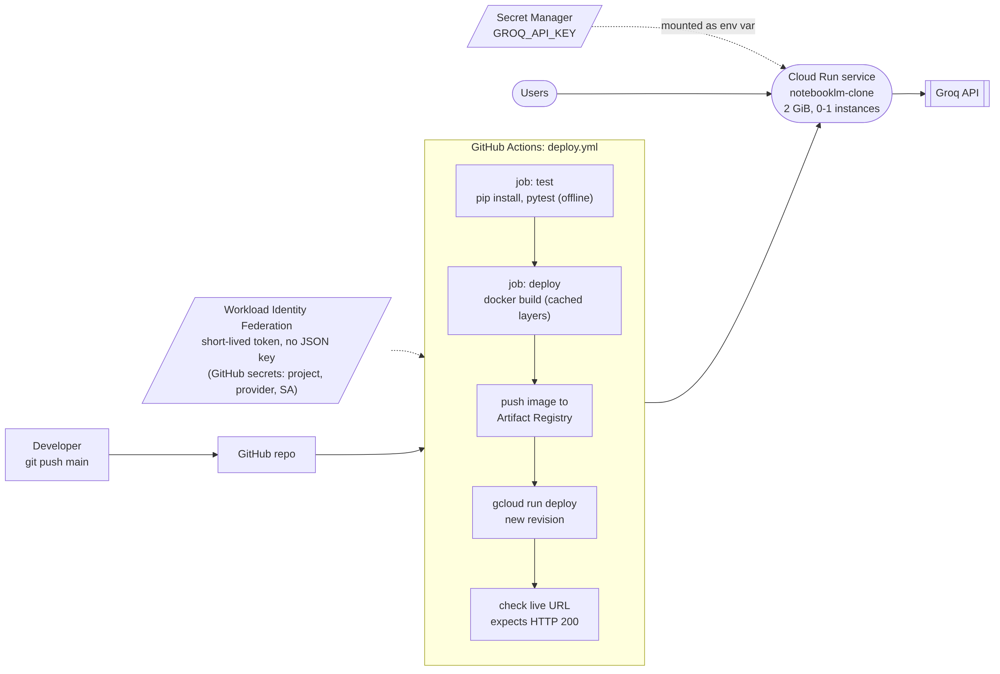

# Architecture

This is a NotebookLM-style app. You make notebooks, add sources (PDF, PPTX, TXT, web pages), chat with those sources and get cited answers, and generate a report, a quiz with answer key, or flashcards. It all runs as one Python process: Gradio for the UI, local ONNX models for embeddings and reranking, ChromaDB for vectors, and Groq for the LLM.


## Layers and modules

The code is split into layers. Each layer only calls the one below it.

| Layer | Module | What it does |
|---|---|---|
| Presentation | `notebooklm/ui/gradio_app.py` | Layout and callbacks. Each callback reads the inputs, calls one service, and turns the result (or a friendly error) into component updates. It has no RAG or file logic. |
| Services | `notebooklm/ingestion/pipeline.py` (`IngestionService`) | Runs a file or URL through extract → save raw → save text → chunk → embed → index. Rejects duplicates and cleans up after itself if a step fails. |
| | `notebooklm/services/chat.py` | Retrieves chunks, builds the grounded prompt, calls the LLM, checks the `[n]` citations against what was retrieved, and saves both messages to the history. |
| | `notebooklm/services/artifacts.py` | Picks context (spread across all sources, or focused on a topic), asks for a report (Markdown) or a quiz/flashcards (JSON), validates the result, renders it to Markdown and saves it. |
| | `notebooklm/services/container.py` | The composition root. It builds every component once and wires them together, so the UI, the tests and the evaluation script all share the same setup. |
| Core | `notebooklm/ingestion/extractors.py` | Text extraction per format. Each one returns *segments*, the smallest citable unit: a PDF page, a slide (including speaker notes and tables), a block of lines in a TXT file, or a heading section of a web page. |
| | `notebooklm/ingestion/chunker.py` | Sliding window of 1000 characters with 150 overlap. The end of each window snaps to a paragraph, line, sentence or word break. Chunks never cross a segment, so each chunk has exactly one locator. |
| | `notebooklm/retrieval/` | `embeddings.py` (bge-small-en-v1.5 via fastembed/ONNX), `vector_store.py` (Chroma behind a `VectorStore` interface), `bm25.py`, `reranker.py` (ms-marco MiniLM cross-encoder), `retriever.py` (the four strategies). |
| | `notebooklm/llm/` | `client.py` is the Groq client. It walks a list of models in order, so a rate-limited or retired model falls through to the next one, and it turns API errors into readable messages. `prompts.py` holds every prompt template. |
| Storage | `notebooklm/storage/base.py` | The `StorageBackend` interface (read/write/append/list/delete by key). |
| | `notebooklm/storage/local.py` | `LocalStorage`: writes are atomic, and any key that would escape the data folder is rejected. |
| | `notebooklm/storage/notebook_store.py` | `NotebookStore`, the only code that knows the folder layout. It handles notebook CRUD, sources, chunks, chat history and artifacts. |
| | `notebooklm/storage/hf_sync.py` | Optional. Restores and backs up notebooks to a private Hugging Face dataset repo, for hosts whose disk is temporary. |
| Config | `notebooklm/config.py` | Every setting comes from environment variables (or `.env`). |

## Data flow

**Adding a source.** The UI passes the uploaded file (or URL) to `IngestionService`, which:

1. checks the type, the size and whether the file is already in the notebook (SHA-256);
2. copies the original into `sources/raw/`;
3. extracts segments and saves them to `sources/text/<id>.json`, plus a readable `.txt` copy;
4. chunks each segment and saves the chunks with their citation metadata to `chunks/<id>.jsonl`;
5. embeds the chunks and upserts them into the notebook's Chroma collection;
6. records the source in `sources/sources.json`.

URLs are fetched with redirects followed by hand, so every hop can be checked against private and loopback addresses. This stops someone from using URL ingestion to reach the server's own network (SSRF). A URL that points to a PDF or a plain-text file goes to that format's extractor.

**Asking a question** (see [chat_sequence.png](diagrams/chat_sequence.png)):

1. `ChatService` loads the recent history. A short follow-up question also borrows the previous question, so retrieval has enough context to work with.
2. `Retriever` runs the selected strategy. It only searches sources that are switched on.
3. The top-k chunks go into the prompt as numbered excerpts `[1]..[k]`. The system prompt says to answer only from the excerpts, cite every claim, and say plainly when the sources don't cover the question.
4. The answer comes back. Any citation pointing at an excerpt that doesn't exist is removed. The rest become the source list (file · page/slide/lines · snippet) shown under the answer.
5. The question and the answer, with its citations, retrieval method, timings and retrieved chunk IDs, are appended to `chats/history.jsonl`.

**Generating an artifact:**

1. Without a focus topic, `Retriever.coverage_sample` takes evenly spaced chunks from every enabled source, up to about 14k characters. That way one long PDF can't crowd out a short slide deck. With a focus topic, the default (hybrid) retriever picks the 14 most relevant chunks instead.
2. The report is generated as Markdown with `[n]` citations, and the app adds a header and a Sources section that maps each `[n]` to its file and page.
3. Quizzes and flashcards are requested as JSON, then validated: 4 options, one correct letter, a supporting excerpt. If the JSON is broken, the model is asked once to fix it. The result is rendered as Markdown, with the answer key in its own section at the end.
4. The `.md` file goes to `artifacts/` and is recorded in `artifacts/index.json`. The UI shows it and offers it as a download.

## Notebook storage

```
data/notebooks/<notebook_id>/
├── notebook.json              id, name, created/updated timestamps
├── sources/
│   ├── sources.json           one record per source: type, origin, sha256, counts, enabled flag
│   ├── raw/<sid>__<file>      original upload (or the fetched HTML/PDF for URLs)
│   └── text/<sid>.json|.txt   extracted text as citable segments
├── chunks/<sid>.jsonl         chunks + metadata (source of truth for BM25 and index rebuilds)
├── vectordb/                  Chroma persistent index for this notebook only
├── chats/history.jsonl        append-only chat log with citations
└── artifacts/
    ├── index.json             artifact records (type, title, model, sources used)
    └── <timestamp>_<type>_<slug>.md
```

A few design choices here:

- **There's no central registry file.** The notebook list is built by scanning `notebooks/*/notebook.json`, so there's no shared index that can get out of sync or corrupted.
- **The vector index is derived data.** `chunks/*.jsonl` is the source of truth. If `vectordb/` is missing or its count doesn't match, it gets rebuilt from the chunk files the first time the notebook is used. That's what lets the optional Hugging Face sync skip the binary Chroma files entirely.
- **Deleting a notebook is safe even on Windows.** The Chroma client is closed first and a `.deleted` marker is written. If a file is still locked, the leftovers are purged on the next start.
- **Untrusted input never becomes a path.** Notebook IDs are validated, file names are sanitized, and every key is resolved and checked against the data root.

## RAG pipeline and retrieval strategies

| Strategy | How it works | Why it exists |
|---|---|---|
| `vector` | Cosine similarity on bge-small embeddings, top-k | The baseline |
| `hybrid` (default) | Dense top-20 + BM25 top-20, merged with Reciprocal Rank Fusion (k=60) | Embeddings blur exact tokens such as `INC-2047`, `OPS-19` or `LX-200`. BM25 matches them exactly. |
| `rerank` | Dense top-20, re-scored by a cross-encoder, keep top-k | The cross-encoder reads the question and the chunk together, which ranks paraphrased questions better |
| `hybrid_rerank` | Hybrid top-20, re-scored by the cross-encoder | Gets the candidates from both sources, then puts the best ones first |

Hybrid is the default because the evaluation found it as accurate as the reranked methods at about 1/25th of the latency on CPU. The comparison (test questions, retrieved chunks, response times, answer quality and the final choice) is in [RAG_EVALUATION.md](RAG_EVALUATION.md).

## Deployment architecture



- **Hosting:** Google Cloud Run. The app runs as one container built from the `Dockerfile` (Python 3.11 slim, dependencies installed, ONNX models baked into the image so cold starts don't download them). The service has 2 GiB of memory and 1 vCPU and scales to zero when idle. It's capped at one instance, so every request sees the same notebook folder.
- **CI/CD:** on every push to `main`, `.github/workflows/deploy.yml` runs the offline test suite. If the tests pass, it builds the image (with Docker layer caching between runs), pushes it to Artifact Registry, deploys a new Cloud Run revision, and finally requests the live URL and fails the run unless it gets HTTP 200. A green run therefore means the new version is actually serving.
- **Credentials and secrets:** GitHub authenticates to Google with Workload Identity Federation: GitHub issues a short-lived OIDC token, and Google exchanges it for access to a deploy-only service account. That access is restricted to this one repository, so no JSON key exists anywhere. The repository secrets `GCP_PROJECT_ID`, `GCP_WIF_PROVIDER` and `GCP_SERVICE_ACCOUNT` hold the identifiers. `GROQ_API_KEY` lives in Google Secret Manager and is mounted into the container as an environment variable at deploy time. The repo itself only contains `.env.example`. `scripts/gcp_setup.sh` creates all of this in one run from Cloud Shell.
- **Why Cloud Run and not Hugging Face Spaces:** Hugging Face now requires a paid plan for new Gradio and Docker Spaces. Cloud Run's free tier covers a class project, and the same container would run unchanged on any other container host.

## Trade-offs

- **Single process, no auth by default.** That's fine for a personal research tool. Setting `APP_USERNAME`/`APP_PASSWORD` turns on Gradio's login. A real multi-user product would need user-scoped notebooks.
- **Local ONNX models instead of an embeddings API.** No extra API key and no per-token cost, and the install doesn't need PyTorch. The cost is about 150 MB of model download and CPU time when ingesting.
- **Ephemeral disk on Cloud Run.** Notebooks on the deployed app live on the container's in-memory disk and are lost when the service scales to zero or redeploys. The app documents this instead of adding infrastructure. Optional sync to a private Hugging Face dataset repo (`HF_DATASET_REPO`) keeps notebooks across restarts, with the risk of losing up to two minutes of changes.
- **Groq free tier.** It's fast, but rate limits are per model, so the client falls back to other models. Artifact context is capped at about 14k characters to stay under the tokens-per-minute limit.
